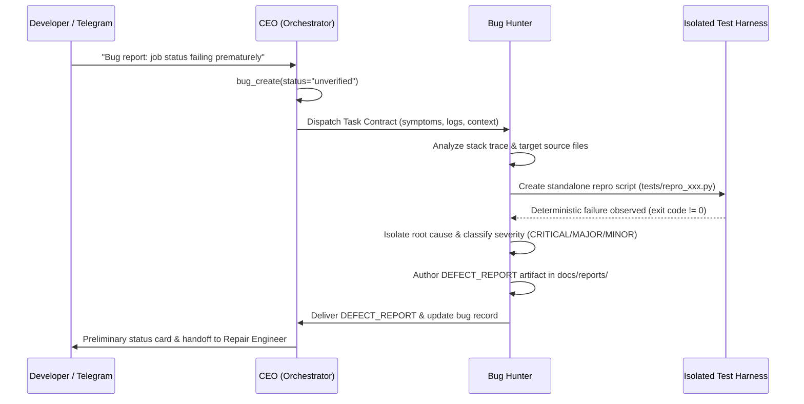

# Standard Workflow: Bug Investigation (`bug_investigation.md`)

**Workflow Identifier**: `wf_bug_investigation`  
**Governing Roles**: CEO (`aegis-orchestrator`), Bug Hunter (`aegis-bug-hunter`)  
**Strict Exclusion**: Bug Hunter never modifies production code or attempts patches.  
**Phase Output**: Formally verified `DEFECT_REPORT` artifact and reproducible test script.  

---

## 1. Trigger Conditions
- User reports a defect, crash, or unexpected behavior via Telegram or n8n webhook.
- Automated background job or Antigravity task terminates with a non-zero exit code.
- Automated health check or daily standup scan detects an unhandled exception or data anomaly.
- Developer provides a stack trace or log excerpt showing runtime failure.

---

## 2. Initial Assessment
Upon trigger receipt, the CEO assesses the defect context:
1. **Source & Scope**: Identifies target project (`project_id`), affected modules, and runtime environment.
2. **Defect Ledger Entry**: CEO logs an unverified defect in `data/aegis.db` via `bug_create` (`status="unverified"`).
3. **Reproducibility Evaluation**: Evaluates whether incoming logs contain sufficient traceback information or if additional telemetry is needed.
4. **Task Contract Formulation**: CEO packages symptoms, logs, and constraints into a strongly-typed delegation contract for `aegis-bug-hunter`.

---

## 3. Required Agents & Separation of Duties
- **CEO (`aegis-orchestrator`)**: Performs intake, records initial bug record, dispatches task contract, and oversees handoff.
- **Bug Hunter (`aegis-bug-hunter`)**: Investigates stack traces, creates isolated reproduction scripts, isolates true root causes, assigns severity, and produces `DEFECT_REPORT`.
- **Strict Separation**: Bug Hunter **never edits application source code** or marks bugs resolved.

---

## 4. Agent Execution Order & Workflow Lifecycle


---

## 5. Parallelizable Steps & Concurrency Boundaries
- **Single Threaded Investigation**: Defect diagnosis is primarily sequential to maintain deterministic execution state.
- **Parallel Trace Analysis**: If the defect involves multiple independent components, Bug Hunter can inspect logs and git history in parallel before creating the reproduction script.

---

## 6. Dependencies & Invariants
- **Database Sandboxing**: Reproduction scripts must inherit from `IsolatedTestCase` and operate on temporary databases. Never run against `data/aegis.db`.
- **Bytecode Cleanliness**: Test execution must invoke `python3 -B` to avoid `.pyc` caching in Termux.
- **Target Immutability**: Production code files must remain strictly untouched throughout this workflow.

---

## 7. Required Tools & Capabilities
- **Code & Log Inspection**: `file_read`, `filesystem_inspect`, `git_diff`, `git_log`.
- **Defect Ledger**: `bug_create`, `bug_get`, `bug_update`.
- **Reproduction Script Creation**: `create_file` (scoped strictly to `tests/repro_*.py`).
- **Isolated Execution**: `run_tests` in isolated environment.

---

## 8. Expected Intermediate Results
1. **Standalone Reproduction Script**: `tests/repro_<defect_slug>.py` that deterministically fails.
2. **Deterministic Failure Evidence**: Console output capturing the exact traceback and non-zero exit code.
3. **Structured `DEFECT_REPORT` Artifact**: Document in `docs/reports/DEF_YYYY_NNN.md` detailing root cause, severity, and remediation guidance.

---

## 9. Approval Requirements & Security Gates
- Routine bug investigations proceed autonomously under `RiskLevel.LOW`.
- If reproducing the bug requires executing external network requests or modifying filesystem permissions, CISO review is required.

---

## 10. Failure Handling & Non-Reproducible Defects
- If the bug cannot be reproduced after 3 isolated attempts:
  1. Bug Hunter documents all reproduction parameters, runtime conditions, and logs tested.
  2. Defect status is updated to `INCONCLUSIVE` in `data/aegis.db`.
  3. Bug Hunter returns diagnostic summary to CEO, requesting additional user logs or environment details.

---

## 11. Final Verification & Quality Gates
The investigation is considered verified only when:
1. Reproduction script consistently reproduces the defect symptom.
2. Root cause is mapped to a specific file, method, and failure mechanism.
3. Defect severity is objectively classified.
4. `DEFECT_REPORT` artifact is validated and saved to disk.

---

## 12. Completion Criteria
1. Defect record in SQLite is updated to `status="investigated"` with root cause notes.
2. `DEFECT_REPORT` is committed or saved to `docs/reports/`.
3. Investigation findings delivered to CEO for immediate handoff to `wf_bug_repair`.

---

## 13. User-Facing Reporting
```markdown
### 🔍 Defect Diagnosed: [Defect Title]

**Defect ID**: `DEF-[YYYY]-[NNN]`
**Severity**: `CRITICAL` | `MAJOR` | `MINOR` | `COSMETIC`
**Status**: `VERIFIED_REPRODUCED`

#### Root Cause Analysis
- **Defective File**: [source_file.py](file:///path/to/source.py#L123)
- **Mechanism**: [Summary of failure cause]

#### Reproduction Proof
- **Repro Script**: [repro_script.py](file:///path/to/tests/repro_xxx.py)
- **Output**: Deterministic failure confirmed (Exit code 1)

#### Next Step
Handoff initiated to **Repair Engineer** for surgical remediation and regression test authoring.
```
