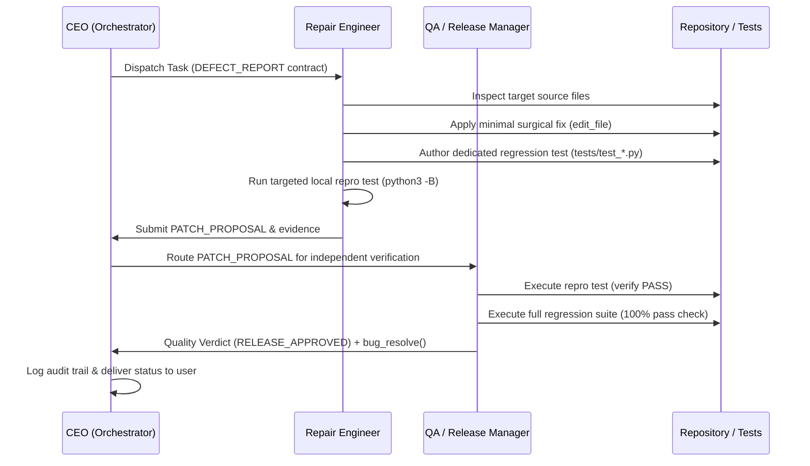

# Standard Workflow: Bug Repair (`bug_repair.md`)

**Workflow Identifier**: `wf_bug_repair`  
**Governing Roles**: CEO (`aegis-orchestrator`), Repair Engineer (`aegis-repair-engineer`), QA/Release Manager (`aegis-qa`)  
**Strict Exclusion**: Repair Engineer never marks bugs resolved in database; QA Manager independently tests and resolves.  
**Phase Output**: Minimal atomic code patch, permanent regression test, verified `PATCH_PROPOSAL`, and defect resolution.  

---

## 1. Trigger Conditions
- Receipt of verified `DEFECT_REPORT` artifact from the `bug_investigation` workflow.
- High-priority defect resolution directive issued by the CEO.
- Automated regression failure in CI requiring immediate patch remediation.

---

## 2. Initial Assessment
The CEO reviews the `DEFECT_REPORT`:
1. **Verification of Input**: Confirms defect is in `VERIFIED_REPRODUCED` status and reproduction script exists.
2. **Blast Radius Analysis**: Assesses affected modules and identifies invariant interfaces that must not break.
3. **Task Assignment Formulation**: Constructs strongly-typed assignment contract for `aegis-repair-engineer` containing defect report URI, constraints, and timeout budget.

---

## 3. Required Agents & Separation of Duties
- **CEO (`aegis-orchestrator`)**: Initiates workflow, assigns remediation task, routes deliverable to QA, and delivers final report.
- **Repair Engineer (`aegis-repair-engineer`)**: Develops minimal surgical patch, writes isolated regression test, verifies local repro fix, and packages `PATCH_PROPOSAL`.
- **QA/Release Manager (`aegis-qa`)**: Independently executes full test suite (100% pass rate enforcement), verifies zero regressions, and calls `bug_resolve`.
- **Strict Separation**: Repair Engineer **NEVER marks bug resolved**; QA Manager **NEVER writes code fixes**.

---

## 4. Agent Execution Order & Workflow Lifecycle


---

## 5. Parallelizable Steps & Concurrency Boundaries
- **Sequential Execution**: Implementation and verification are strictly sequential to guarantee that QA evaluates the exact, unmodified patch produced by the Repair Engineer.
- **Pre-Verification Test Caching**: While Repair Engineer writes the regression test, QA can verify the baseline health of existing test suites.

---

## 6. Dependencies & Invariants
- **Minimal Blast Radius**: Fixes must be surgical, altering only the lines necessary to remediate root causes.
- **Isolated Testing Invariant**: All tests must inherit from `IsolatedTestCase` and run with `python3 -B`.
- **Non-Destructive Invariant**: No production databases, uncommitted working tree files, or Git history may be destroyed.

---

## 7. Required Tools & Capabilities
- **Code Editing**: `file_read`, `edit_file` (scoped strictly within project root via `validate_path_within_project`).
- **Test Authoring & Execution**: `create_file` (for regression test in `tests/`), `run_tests` in isolated sandbox.
- **Git Context**: `git_diff`, `git_status`, `git_log`.
- **Defect Lifecycle**: `bug_get`, `bug_resolve` (QA only).

---

## 8. Expected Intermediate Results
1. **Surgical Source Code Modification**: Targeted patch applied to target source file.
2. **Dedicated Regression Test Case**: Test method added to `tests/test_*.py` that permanently asserts correct behavior.
3. **Structured `PATCH_PROPOSAL` Artifact**: Document in `docs/patches/PATCH_YYYY_NNN.md` detailing diff, rationale, and local test evidence.

---

## 9. Approval Requirements & Security Gates
- Standard scoped bug repairs proceed autonomously under `RiskLevel.LOW`.
- If remediation requires modifying public API contracts, database schemas, or security tokens, CISO and human approval are required.

---

## 10. Failure Handling & Re-Remediation Loop
- If QA detects any test failure (regression or failed repro):
  1. QA issues `RELEASE_REJECTED` with full traceback and diff logs.
  2. CEO returns task to Repair Engineer for cycle 2.
  3. If patch fails after 2 repair attempts, workflow halts and escalates to CEO and CTO for architectural review.

---

## 11. Final Verification & Quality Gates
Before defect is marked resolved:
1. Original reproduction test passes cleanly (Exit code 0).
2. Full automated test suite passes with **100% success rate** (e.g. 117/117 passed).
3. Git diff contains zero unrelated changes or debug statements.
4. QA Manager issues formal `RELEASE_APPROVED` verdict.

---

## 12. Completion Criteria
1. Full test suite passes 100%.
2. Defect marked `resolved` in SQLite database via `bug_resolve`.
3. `PATCH_PROPOSAL` and `QA_VERIFICATION_REPORT` committed to disk.
4. Clean conventional git commit created (`fix(scope): description`).

---

## 13. User-Facing Reporting
```markdown
### ✅ Defect Remediated & Verified: [Defect Title]

**Defect ID**: `DEF-[YYYY]-[NNN]`
**Status**: `RESOLVED`
**Resolution**: Minimal surgical patch verified by QA

#### Code Modifications
- [source_file.py](file:///path/to/source.py#L120-L135): [Description of fix]
- [test_suite.py](file:///path/to/tests/test_suite.py#L45-L60): Added permanent regression test

#### QA Verification Proof
- **Full Test Suite**: `117/117 passed (100%)` in `48.2s`
- **Repro Script**: `PASS` (Exit code 0)
- **Commit**: `fix(scope): remediate edge condition in job status`
```
