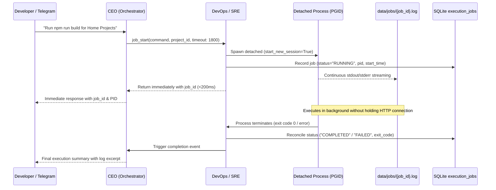

# Standard Workflow: Build & Deployment (`build_and_deployment.md`)

**Workflow Identifier**: `wf_build_and_deployment`  
**Governing Roles**: CEO (`aegis-orchestrator`), DevOps/SRE (`aegis-devops`), CISO (`aegis-ciso`)  
**Runtime Architecture**: Detached process group (`start_new_session=True`), continuous disk log streaming, non-blocking HTTP return (<200ms).  
**Phase Output**: Asynchronous build execution, persistent log artifact, process exit code, and completion alert.  

---

## 1. Trigger Conditions
- User requests build, compilation, bundle, or packaging operations via Telegram (e.g. *"npm run build"*, *"vite build"*, *"python -m build"*).
- Managing or inspecting Antigravity CLI instances (*"Start Agy instance"*, *"Check instance status"*, *"Stop instance"*).
- Running long-running test suites or database maintenance jobs.

---

## 2. Initial Assessment
The CEO performs execution assessment:
1. **Target Project & Path**: Resolves project identifier and validates working directory using `validate_path_within_project()`.
2. **Command Validation**: Pre-tokenizes command string into argument lists (`["npm", "run", "build"]`) and verifies `shell=False`.
3. **Execution Mode**: Routes long-running commands to asynchronous background execution (`job_start`).
4. **Immediate Dispatch**: Invokes `aegis-devops` via `job_start`.

---

## 3. Required Agents & Separation of Duties
- **CEO (`aegis-orchestrator`)**: Performs pre-flight checks, dispatches job, provides immediate acknowledgement to user, and sends final completion card.
- **DevOps/SRE (`aegis-devops`)**: Spawns detached process group, monitors `/proc`, streams logs to `data/jobs/<job_id>.log`, records state transitions, and enforces timeouts.
- **CISO (`aegis-ciso`)**: Validates that commands do not attempt privilege escalation or access unauthorized system paths.
- **Strict Separation**: DevOps manages runtime processes; does not modify application code.

---

## 4. Agent Execution Order & Workflow Lifecycle


---

## 5. Parallelizable Steps & Concurrency Boundaries
- **Asynchronous Detachment**: The build command executes completely detached in the background, allowing the CEO to handle subsequent user queries concurrently.
- **Concurrent Log Streaming**: Process stdout and stderr stream concurrently to disk without blocking the main event loop.

---

## 6. Dependencies & Invariants
- **Process Group Isolation**: Subprocesses must execute with `start_new_session=True` so they survive parent daemon reloads.
- **Log Persistence Invariant**: All process output must write directly to `data/jobs/<job_id>.log`.
- **Pre-Tokenized Invariant**: Commands must execute with `shell=False` via tokenized argument lists.
- **Timeout Invariant**: Operation-specific timeouts must be enforced (default 1800s for builds, 300s for scripts).

---

## 7. Required Tools & Capabilities
- **Background Execution**: `job_start`, `job_get`, `job_logs`, `job_cancel`.
- **Antigravity Instances**: `agy_instance_list`, `agy_instance_status`, `agy_instance_start`, `agy_instance_stop`.
- **Filesystem & Logs**: `filesystem_inspect`, `file_read` (scoped to `data/jobs/*.log`).

---

## 8. Expected Intermediate Results
1. **Immediate Job Allocation**: Unique `job_id` (`job_YYYYMMDD_xxxx`) returned in <200ms.
2. **Persistent Log File**: Real-time log file at `data/jobs/<job_id>.log`.
3. **Process State in SQLite**: Live status record in `execution_jobs` table.

---

## 9. Approval Requirements & Security Gates
- Standard project builds (`npm run build`, `make`) proceed autonomously under `RiskLevel.LOW`.
- Commands requesting root privileges, system package installations (`pkg install`), or deletion of uncommitted files require explicit human approval.

---

## 10. Failure Handling & Process Recovery
- If a build fails (exit code != 0), DevOps captures the failure output, reconciles the database to `FAILED`, and CEO delivers the error excerpt to the user.
- If a process hangs beyond its timeout, DevOps dispatches `SIGTERM`, waits 5 seconds, and escalates to `SIGKILL` to prevent resource leaks.
- If daemon restarts mid-build, DevOps inspects `/proc` on startup and reconciles stale jobs.

---

## 11. Final Verification & Quality Gates
1. Process exit code confirmed to be 0 for successful builds.
2. Build artifacts verified in target output directory (e.g. `dist/` or `build/`).
3. No orphan subprocesses lingering in `/proc`.
4. Log file verified flushed and closed.

---

## 12. Completion Criteria
1. Subprocess terminates and exit code is captured.
2. SQLite `execution_jobs` record marked `COMPLETED`.
3. Final status report delivered to user with execution duration and log excerpt.

---

## 13. User-Facing Reporting

### Immediate Acknowledgement (<200ms)
```markdown
⏱️ **Build Started in Background**
- **Job ID**: `job_20261115_04a9`
- **Command**: `npm run build`
- **PID**: `14892`
- **Status**: `RUNNING`
*I will notify you immediately when the build completes.*
```

### Final Completion Delivery
```markdown
### 🔨 Build Completed Successfully: [Project Name]

**Job ID**: `job_20261115_04a9`
**Status**: ✅ `COMPLETED` (Exit Code 0)
**Duration**: `18.4s`

#### Build Output Summary
```text
✓ 42 modules transformed.
dist/index.html                   0.48 kB │ gzip:  0.31 kB
dist/assets/index-D7h2k9a.css     1.24 kB │ gzip:  0.64 kB
dist/assets/index-B2k19fa.js     48.12 kB │ gzip: 16.24 kB
✓ built in 840ms
```

#### Artifact Verification
Artifacts verified in `dist/`. Workspace clean.
```
