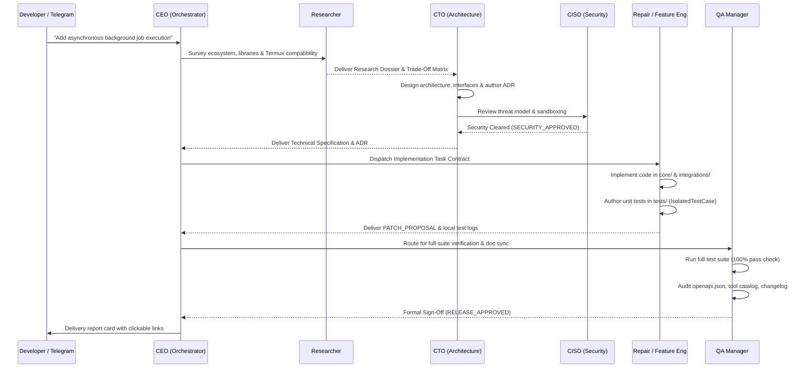

# Standard Workflow: Feature Development (`feature_development.md`)

**Workflow Identifier**: `wf_feature_development`  
**Governing Roles**: CEO (`aegis-orchestrator`), CTO (`aegis-cto`), Researcher (`aegis-researcher`), Repair Engineer (`aegis-repair-engineer`), CISO (`aegis-ciso`), QA/Release Manager (`aegis-qa`)  
**Strict Exclusion**: Bug Hunter is not summoned unless an unexpected regression is discovered during test passes.  
**Phase Output**: Architectural Decision Record (ADR), technical specification, feature implementation, isolated tests, and synced documentation.  

---

## 1. Trigger Conditions
- User submits a new capability request, architectural enhancement, or feature directive via Telegram.
- Progressing an active milestone task from `ROADMAP.md` or `TASKS.md`.
- Scheduled evolution of API endpoints, tool dispatchers, or integration connectors.

---

## 2. Initial Assessment
The CEO performs strategic intake:
1. **Scope Classification**: Classifies feature as Minor (scoped enhancement) or Major (multi-component or schema-altering).
2. **Task Registration**: Registers feature task in SQLite via `task_create` (`status="in_progress"`).
3. **Requirement Clarification**: Resolves any ambiguities directly with the user before committing engineering effort.
4. **Council Convening**: If the feature is Major, convenes the Technical Council (Researcher, CTO, CISO).

---

## 3. Required Agents & Separation of Duties
- **CEO (`aegis-orchestrator`)**: Intent parsing, task lifecycle tracking, pipeline routing, and final user delivery.
- **Researcher (`aegis-researcher`)**: Surveys external documentation, libraries, community consensus, and Termux compatibility.
- **CTO (`aegis-cto`)**: Designs modular architecture, public API schemas, and authors formal ADRs.
- **CISO (`aegis-ciso`)**: Evaluates threat model (STRIDE), verifies path sandboxing, and reviews auth boundaries.
- **Repair Engineer (`aegis-repair-engineer`)**: Implements application code and writes unit/integration tests according to CTO specifications.
- **QA Manager (`aegis-qa`)**: Executes full regression suites, validates acceptance criteria, audits documentation sync, and approves release.

---

## 4. Agent Execution Order & Workflow Lifecycle


---

## 5. Parallelizable Steps & Concurrency Boundaries
- **Research & Threat Scoping**: Researcher surveys external tools while CISO reviews potential threat vectors in parallel.
- **Sequential Implementation**: Code implementation strictly follows approved CTO architectural specifications.
- **Parallel Testing & Doc Review**: QA runs regression test suites while auditing documentation synchronization in parallel.

---

## 6. Dependencies & Invariants
- **Layered Architecture**: Code must adhere to API -> Core -> Storage/Integrations layering.
- **Database Migrations**: Any schema additions must be implemented via idempotent migrations in `storage/migrations.py`.
- **Zero Production DB Contamination**: All feature tests must inherit from `IsolatedTestCase`.
- **Bytecode Prevention**: Test commands must execute with `python3 -B`.

---

## 7. Required Tools & Capabilities
- **Research & Intelligence**: `search_web`, `memory_record`, `memory_search`.
- **Architectural & Code Editing**: `file_read`, `edit_file`, `create_file` (sandboxed to project root).
- **Git Context**: `git_status`, `git_diff`, `git_log`.
- **Task & Defect Management**: `task_create`, `task_update`, `task_list`.
- **Test Execution**: `run_tests` in isolated environments.

---

## 8. Expected Intermediate Results
1. **Research Dossier**: In `docs/research/` detailing libraries and trade-offs.
2. **Architectural Decision Record (ADR)**: In `docs/adr/` specifying architecture, interfaces, and schemas.
3. **Application Source Code**: New or modified modules in project repository.
4. **Automated Unit & Integration Tests**: Comprehensive tests in `tests/`.
5. **Updated Documentation**: Synced `docs/openapi.json`, `docs/AEGIS_N8N_TOOL_CATALOG.md`, and `CHANGELOG.md`.

---

## 9. Approval Requirements & Security Gates
- Minor internal features proceed autonomously under `RiskLevel.LOW`.
- Major architectural changes, public API breaking modifications, or dependency additions require explicit user approval.
- Any change affecting path sandboxing or API token authentication requires CISO approval.

---

## 10. Failure Handling & Circuit Breakers
- If proposed architecture violates Termux constraints, CTO halts and redesigns with lightweight alternatives.
- If QA discovers test regressions, the feature branch is rejected back to the Repair Engineer.
- Maximum 2 remediation cycles allowed before escalating to CEO for requirement realignment.

---

## 11. Final Verification & Quality Gates
1. 100% test pass rate across the full test suite.
2. New feature acceptance criteria confirmed satisfied with dedicated test cases.
3. Documentation synchronized across OpenAPI, tool catalog, and changelog.
4. CISO verifies no security invariants were compromised.

---

## 12. Completion Criteria
1. All planned tasks marked `completed` in `data/aegis.db`.
2. Clean Git commit created following conventional commits (`feat(scope): description`).
3. QA Manager issues formal `RELEASE_APPROVED` verdict.
4. CEO delivers delivery report with clickable links to user.

---

## 13. User-Facing Reporting
```markdown
### 🌟 Feature Implemented: [Feature Title]

**Project**: [Project Name] (`[project_id]`)
**Status**: ✅ RELEASE_APPROVED
**Commit**: `feat(scope): implement asynchronous background jobs`

#### Architecture & Deliverables
- [Architectural Decision Record](file:///path/to/docs/adr/ADR_xxx.md) — System Design
- [Core Module](file:///path/to/core/new_feature.py) — Implementation
- [Test Suite](file:///path/to/tests/test_feature.py) — Automated Tests

#### Verification & Quality Proof
- **Full Test Suite**: `117/117 passed (100%)` in `49.1s`
- **Documentation**: Synced across OpenAPI, Tool Catalog, and Changelog
- **Security Audit**: Cleared by CISO (Zero vulnerabilities)
```
