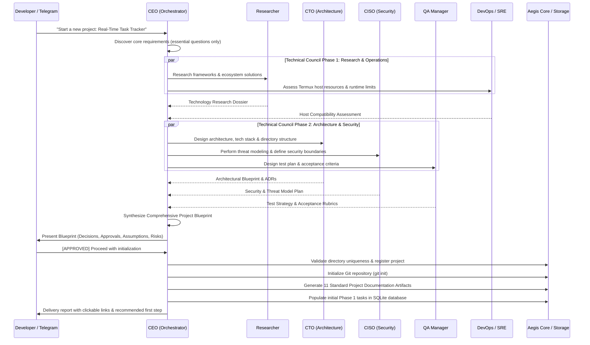

# Standard Workflow: New Project Onboarding & Lifecycle (`new_project_onboarding.md`)

**Workflow Identifier**: `wf_new_project_onboarding`  
**Governing Roles**: CEO (`aegis-orchestrator`), Researcher (`aegis-researcher`), CTO (`aegis-cto`), CISO (`aegis-ciso`), QA Manager (`aegis-qa`), DevOps/SRE (`aegis-devops`)  
**Strict Exclusion**: `aegis-bug-hunter` and `aegis-repair-engineer` are strictly banned during onboarding (there is no code or defect to diagnose yet).  
**Primary Deliverables**: Approved Project Blueprint, Registered Aegis Project, Git Repository, and 11 Standard Project Documentation Artifacts.  

---

## 1. Trigger Conditions
The CEO initiates this workflow when a developer expresses intent to create, bootstrap, or plan a new software project. Natural language triggers include:
- *"Start a new project"*
- *"I want to build an application for [purpose]"*
- *"Create a new website / tool / API"*
- *"Let's develop a new software product"*
- *"Initialize a project from this idea"*
- *"Bootstrap a repository for [idea]"*

---

## 2. Initial Assessment & Requirements Discovery
The CEO assesses the request to understand foundational requirements before summoning technical specialists.
To avoid developer fatigue, the CEO **asks only essential questions that materially alter the project plan**:

1. **Core Purpose & Objectives**: What primary problem does this application solve?
2. **Target Users & Platform**: Is this a CLI tool, web application, backend API, or mobile utility? Will it run in Termux, Node.js, Python, or standard Linux?
3. **Primary Constraints & Preferences**: Are there mandatory languages, frameworks, or database choices?
4. **Performance & Security Expectations**: Are there sensitive credentials, multi-user requirements, or strict memory/latency budgets?

> [!TIP]
> **Minimal Friction Principle**: If the user provides sufficient details in their initial prompt (e.g. *"Build a FastAPI SQLite backend for inventory tracking in Termux"*), the CEO bypasses clarification questions and proceeds directly to agent delegation.

---

## 3. Required Agents & Separation of Duties

| Agent | System ID | Mandatory Role in Onboarding |
|---|---|---|
| **CEO** | `aegis-orchestrator` | Triage, requirements intake, Technical Council coordination, user approval gate, project registration, delivery |
| **Researcher** | `aegis-researcher` | Investigates ecosystem solutions, framework comparisons, library battle-testing, and Termux compatibility |
| **CTO** | `aegis-cto` | Designs modular architecture, selects tech stack, defines directory structure, and establishes ADRs |
| **CISO** | `aegis-ciso` | Conducts initial threat modeling (STRIDE), specifies path sandboxing, and defines secret/auth policies |
| **QA Manager** | `aegis-qa` | Establishes testing strategy, defines acceptance criteria, and configures isolated test harness standards |
| **DevOps/SRE** | `aegis-devops` | Evaluates Termux host resource feasibility, defines build/run execution plans, and verifies Git setup |
| **Bug Hunter** | `aegis-bug-hunter` | **STRICTLY EXCLUDED** (No existing codebase or defect to investigate) |
| **Repair Engineer**| `aegis-repair-engineer`| **STRICTLY EXCLUDED** (Implementation begins only after onboarding approval) |

---

## 4. Agent Execution Order & Workflow Lifecycle



---

## 5. Parallelizable Steps & Concurrency Boundaries
1. **Parallel Phase 1 (Intelligence & Runtime)**:
   - `aegis-researcher` and `aegis-devops` run concurrently.
   - Researcher surveys PyPI/npm and GitHub, while DevOps profiles local Termux RAM, disk, and CPU capabilities.
2. **Sequential Transition**:
   - CTO requires the Researcher's dossier and DevOps constraints before finalizing architectural specifications.
3. **Parallel Phase 2 (Specification & Assurance)**:
   - `aegis-cto`, `aegis-ciso`, and `aegis-qa` run concurrently to author respective sections of the project blueprint.
4. **Synchronization Barrier**:
   - CEO aggregates all specialist outputs into the unified Project Blueprint and presents it to the user.

---

## 6. Dependencies & Invariants
- **Uniqueness Check**: Target project name and directory must not collide with existing registered projects or directories.
- **Location Sandboxing**: All new project directories must reside within approved user workspace roots (e.g. `/data/data/com.termux/files/home/<project-name>`).
- **Zero Production Contamination**: Project creation operations must use documented API routes (`project_register`, `task_create`) and never directly inject raw SQL into `data/aegis.db`.

---

## 7. Required Tools & Capabilities
- **Project Registration**: `project_register`, `project_get`, `project_list`.
- **Filesystem & Validation**: `filesystem_inspect`, `validate_path_within_project`, `create_file`.
- **Git Integration**: `git_init` / `git_command(["init"])`, `git_status`.
- **Task Management**: `task_create`, `task_list`.
- **Research & Memory**: `search_web`, `memory_record`, `memory_search`.

---

## 8. Expected Intermediate Results & Project Blueprint
Prior to physical project initialization, the CEO synthesizes specialist recommendations into a formal **Project Blueprint** presented to the developer:

### Blueprint Sections:
1. **Project Overview & Objectives**: Purpose, user personas, and target outcomes.
2. **Recommended Technology Stack**: Selected language, framework, database, and libraries with rationale.
3. **Proposed System Architecture**: Component layout, data flow, API contracts, and directory structure.
4. **Implementation Roadmap**: Phased milestones (Phase 1 MVP, Phase 2 Core Features, Phase 3 Hardening).
5. **Testing & Quality Assurance Strategy**: Test frameworks, test types (unit/integration/E2E), and coverage targets.
6. **Security & Threat Mitigation Plan**: Authentication, secret management, input sanitization, and data sandboxing.
7. **Explicit Governance Items**:
   - **Recommended Decisions**: Key architectural and technical choices.
   - **Items Requiring User Approval**: External services, paid APIs, or structural trade-offs.
   - **Assumptions Made**: Operating environment, traffic volume, or user expectations.
   - **Unresolved Questions**: Clarifications deferred to future phases.
   - **Potential Implementation Risks**: Performance constraints on mobile, dependency deprecations.

---

## 9. Approval Requirements & Initialization Gates
- Physical directory creation, Git repository initialization, and database registration are **strictly blocked** until the developer explicitly approves the Project Blueprint via Telegram or CLI.
- If the developer requests modifications to the Blueprint, the CEO summons the affected specialist (e.g. CTO to change database from PostgreSQL to SQLite) and re-presents the updated Blueprint.

---

## 10. Project Workspace Initialization (11 Standard Documents)
Upon developer approval, the CEO executes the physical initialization sequence:

1. **Directory Creation**: Create `/data/data/com.termux/files/home/<project-slug>/` using safe path validation.
2. **Aegis Registration**: Register the project in `data/aegis.db` via `project_register` (`project_id: proj_<name>_<hash>`).
3. **Git Initialization**: Initialize local Git repository (`git init`) and set initial branch `main`.
4. **Standard Documentation Generation**: Generate 11 mandatory markdown files in the project root:

| # | Document Filename | Primary Content & Purpose |
|---|---|---|
| 1 | `PROJECT_BRIEF.md` | Executive vision, problem statement, target audience, and business goals |
| 2 | `REQUIREMENTS.md` | Functional and non-functional requirements with verifiable acceptance criteria |
| 3 | `ARCHITECTURE.md` | System architecture, component relationships, data flows, and layer boundaries |
| 4 | `TECH_STACK.md` | Languages, frameworks, tools, runtime constraints, and dependency rationales |
| 5 | `ROADMAP.md` | Milestone breakdown, phased delivery schedule, and release targets |
| 6 | `TASKS.md` | Initial backlog of actionable engineering tasks mapped to Phase 1 |
| 7 | `BUGS.md` | Empty initialized defect tracking ledger for runtime defects |
| 8 | `SECURITY.md` | Threat model, authentication rules, secret handling, and path sandboxing |
| 9 | `TEST_PLAN.md` | Testing strategy, test suites, isolated test harnesses, and acceptance benchmarks |
| 10| `DECISIONS.md` | Initial Architectural Decision Records (ADR 001: Architecture & Tech Stack) |
| 11| `CHANGELOG.md` | Semantic version tracking initialized at `v0.1.0-dev` |

5. **Initial Git Commit**: Stage all 11 documentation files and create the initial conventional commit:
   `chore(project): initialize project structure and governance documentation`.
6. **SQLite Task Ledger Seeding**: Seed Phase 1 tasks in `data/aegis.db` via `task_create`.

---

## 11. Failure Handling & Rollback Protocol
- **Duplicate Project Name**: If the project name or directory already exists, the CEO halts immediately, alerts the user, and suggests alternate naming.
- **Filesystem Permission Denied**: If Termux storage permissions fail, DevOps diagnoses permissions and requests user storage grant.
- **Rollback on Aborted Initialization**: If file generation fails mid-sequence, partial files are cleanly rolled back, preventing orphaned or unindexed directories.

---

## 12. Final Verification & Quality Gates
Before declaring onboarding complete, the CEO validates:
1. `project_get` confirms active registration in `data/aegis.db`.
2. All 11 markdown files exist on disk, are non-empty, and contain project-specific details.
3. `git_status` confirms a clean Git working tree on branch `main`.
4. Initial tasks appear in `task_list`.

---

## 13. User-Facing Reporting & Subsequent Development Lifecycle

### User Delivery Card
```markdown
### 🚀 Project Successfully Onboarded: [Project Name]

**Project Identifier**: `[project_id]`
**Workspace Directory**: `[workspace_path]`
**Git Repository**: Initialized (`main` @ `[commit_hash]`)
**Status**: ✅ READY_FOR_DEVELOPMENT

#### Governance & Architectural Documents
- [PROJECT_BRIEF.md](file:///path/to/PROJECT_BRIEF.md) — Executive Vision
- [ARCHITECTURE.md](file:///path/to/ARCHITECTURE.md) — System Blueprint
- [TECH_STACK.md](file:///path/to/TECH_STACK.md) — Technology Stack
- [ROADMAP.md](file:///path/to/ROADMAP.md) — Delivery Milestones
- [TASKS.md](file:///path/to/TASKS.md) — Phase 1 Task Backlog
- [SECURITY.md](file:///path/to/SECURITY.md) — Security & Sandboxing Rules
- [TEST_PLAN.md](file:///path/to/TEST_PLAN.md) — Verification Strategy

#### Initial Phase 1 Backlog
1. `[TSK-001]`: Setup core project scaffolding and virtual environment
2. `[TSK-002]`: Implement baseline API schema and storage models
3. `[TSK-003]`: Author isolated unit tests for core domain logic

#### Recommended Next Step
To begin implementing Phase 1, tell me:
*"Start working on task TSK-001"* or *"Launch Antigravity instance for this project"*
```

### Subsequent Operating Lifecycle
Once onboarded, the eight-agent organization executes normal development routines:
1. **Feature Implementation**: CEO dispatches tasks from `TASKS.md` to `aegis-repair-engineer`, verified by `aegis-qa` (`feature_development`).
2. **Defect Remediation**: Uncovered bugs are recorded in `BUGS.md`, diagnosed by `aegis-bug-hunter`, repaired by `aegis-repair-engineer`, and closed by `aegis-qa` (`bug_investigation` + `bug_repair`).
3. **Persistent Context Maintenance**:
   - `TASKS.md` is updated as tasks transition to `COMPLETED`.
   - `DECISIONS.md` records new ADRs as architectural trade-offs occur.
   - `ARCHITECTURE.md` remains strictly synchronized with live source code.
   - `CHANGELOG.md` tracks milestone progressions.
