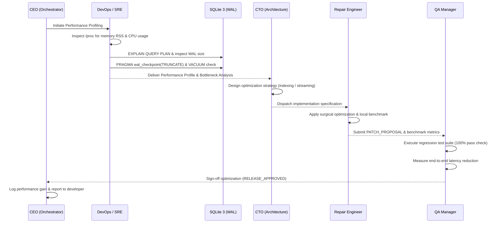

# Standard Workflow: Performance Optimization (`performance_optimization.md`)

**Workflow Identifier**: `wf_performance_optimization`  
**Governing Roles**: CEO (`aegis-orchestrator`), DevOps/SRE (`aegis-devops`), CTO (`aegis-cto`), Repair Engineer (`aegis-repair-engineer`), QA Manager (`aegis-qa`)  
**Host Target**: Termux on Android (Linux aarch64, RAM constraints, SQLite WAL)  
**Phase Output**: Resource Profile Report, WAL Checkpoint Certification, Optimization Patch, and Benchmark Proof.  

---

## 1. Trigger Conditions
- Dispatch tool latency or local HTTP endpoint response times exceed 300ms.
- Host memory utilization in Termux approaches Android background kill thresholds (>300MB RSS).
- Database lock contention, busy timeouts, or slow query plans detected in `data/aegis.db`.
- Log files or database WAL files grow beyond safe operational storage budgets.

---

## 2. Initial Assessment
The CEO reviews telemetry:
1. **Bottleneck Identification**: Categorizes latency as database I/O, process spawn overhead, unbounded memory buffering, or algorithmic complexity.
2. **Resource Snapshot**: Inspects current memory footprint and active job count via `project_assessment`.
3. **Dispatch to DevOps**: Issues performance profiling directive to `aegis-devops`.

---

## 3. Required Agents & Separation of Duties
- **CEO (`aegis-orchestrator`)**: Initiates audit, coordinates handoffs, and delivers performance gain summary.
- **DevOps/SRE (`aegis-devops`)**: Profiles host memory, monitors `/proc`, analyzes SQLite query plans, runs WAL checkpoints, and identifies bottlenecks.
- **CTO (`aegis-cto`)**: Reviews proposed data structure or indexing changes against architectural standards.
- **Repair Engineer (`aegis-repair-engineer`)**: Implements surgical optimizations (e.g. database indexes, stream slicing, lazy loading).
- **QA Manager (`aegis-qa`)**: Runs regression suites, measures before/after latency benchmarks, and verifies 100% test pass rate.

---

## 4. Agent Execution Order & Workflow Lifecycle


---

## 5. Parallelizable Steps & Concurrency Boundaries
- **Parallel Host & DB Profiling**: DevOps profiles process memory in `/proc` while executing SQLite query plan diagnostics concurrently.
- **Sequential Optimization Implementation**: Code optimizations must follow CTO architectural review to prevent risky micro-optimizations.

---

## 6. Dependencies & Invariants
- **Non-Destructive Invariant**: Optimizations must never drop tables, discard audit logs, or lose uncommitted data.
- **WAL Invariant**: SQLite WAL mode and busy timeouts must remain strictly active.
- **Zero Regression Invariant**: 100% test pass rate required after optimizations are applied.

---

## 7. Required Tools & Capabilities
- **Host & Process Metrics**: `/proc` inspection via DevOps, `filesystem_inspect`.
- **Database Profiling**: SQLite query execution, WAL maintenance tools.
- **Code Optimization**: `file_read`, `edit_file` within project root.
- **Verification**: `run_tests` in isolated environment.

---

## 8. Expected Intermediate Results
1. **Performance Profile Artifact**: Document detailing memory RSS, query latency, and hot paths.
2. **Database WAL Checkpoint**: Verified reduction of `aegis.db-wal` size and clean checkpoint log.
3. **Surgical Optimization Patch**: Code change introducing indexes, generators, or streaming buffers.
4. **Benchmark Proof**: Quantitative latency comparison before vs. after optimization.

---

## 9. Approval Requirements & Security Gates
- Routine database WAL checkpoints and indexing proceed autonomously under `RiskLevel.LOW`.
- Changes requiring database schema alterations or changes to retention policies require user approval.

---

## 10. Failure Handling & Reversion
- If an optimization introduces instability or test failures, QA rejects the patch immediately.
- Repair Engineer reverts the patch to maintain system stability before exploring alternate optimization avenues.

---

## 11. Final Verification & Quality Gates
1. Latency reduced by at least 20% on the target operation.
2. Memory consumption stays within safe Android/Termux limits (<200MB RSS).
3. 100% test pass rate maintained across the full test suite.
4. QA Manager issues formal `RELEASE_APPROVED` sign-off.

---

## 12. Completion Criteria
1. Optimization code committed via conventional commit (`perf(scope): description`).
2. Performance gains documented and verified.
3. Final summary delivered to CEO.

---

## 13. User-Facing Reporting
```markdown
### ⚡ Performance Optimization Complete: [Target Area]

**Status**: ✅ RELEASE_APPROVED
**Optimized Component**: [Database / Log Streaming / API Dispatcher]

#### Measured Performance Gains
- **Latency**: `380ms` → `65ms` (**83% faster**)
- **Memory Footprint**: `185 MB` → `94 MB` (**49% reduction**)
- **Database WAL**: Checkpointed cleanly to `0 KB`

#### Verification Proof
- **Tests**: `117/117 passed (100%)` in `46.5s`
- **Commit**: `perf(dispatcher): add sqlite indexing on execution_jobs`
```
