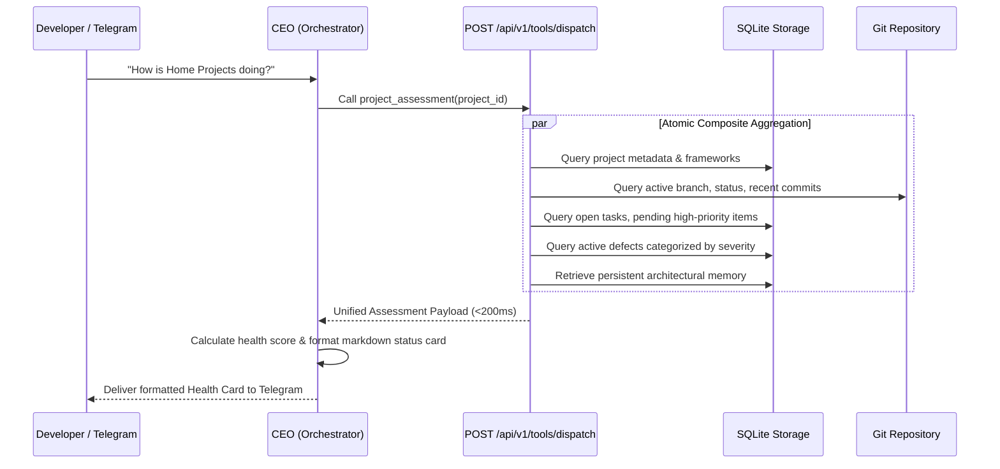

# Standard Workflow: Project Health Check (`project_health_check.md`)

**Workflow Identifier**: `wf_project_health_check`  
**Governing Roles**: CEO (`aegis-orchestrator`), DevOps/SRE (`aegis-devops`)  
**Design Principle**: High-density composite tool execution (`project_assessment`). Resolves full multi-domain status in a single roundtrip (<200ms) without multi-turn LLM loops.  
**Phase Output**: Unified Project Health Card, Git status, Task/Bug breakdown, and empirical metrics.  

---

## 1. Trigger Conditions
- User asks for project status, summary, or health overview via Telegram (*"How is Home Projects doing?", "Project status", "Show tasks and bugs"*).
- Routine daily standup check or periodic automated health scan.
- Context priming prior to launching new engineering tasks.

---

## 2. Initial Assessment
The CEO performs rapid intent routing:
1. **Target Identification**: Resolves project identifier from user context or default active project.
2. **Execution Strategy**: Employs the single-call composite tool `project_assessment`, bypassing manual tool looping across git, filesystem, and database tables.
3. **Execution Context**: Executed directly by the CEO under Solo Executive Execution mode.

---

## 3. Required Agents & Separation of Duties
- **CEO (`aegis-orchestrator`)**: Dispatches composite assessment tool, parses unified data dictionary, and formats executive Telegram response.
- **DevOps/SRE (`aegis-devops`)**: Summoned only if host-level system metrics (RAM, CPU, disk) or running Antigravity instances need deeper investigation.
- **Strict Separation**: Subordinate agents are not summoned for routine health checks to prevent token waste and latency.

---

## 4. Agent Execution Order & Workflow Lifecycle


---

## 5. Parallelizable Steps & Concurrency Boundaries
- **Internal Database/Git Concurrency**: The composite `project_assessment` backend queries SQLite tables and Git status concurrently within a single HTTP request.
- **Single-Turn Delivery**: The entire workflow completes in a single LLM conversational turn.

---

## 6. Dependencies & Invariants
- **Read-Only Invariant**: Health checks must never modify codebase files, alter Git state, or change database records.
- **Speed Invariant**: Execution must complete and return to Telegram in under 500ms.
- **Resilience Invariant**: If Git is uninitialized or SQLite returns empty tasks, the tool gracefully returns partial data without throwing errors.

---

## 7. Required Tools & Capabilities
- **Composite Tool**: `project_assessment` (alias: `project_status_report`).
- **Targeted Fallbacks**: `project_get`, `git_status`, `task_summary`, `bug_summary`.

---

## 8. Expected Intermediate Results
1. **Unified Health Payload**: JSON response containing `project`, `git`, `tasks`, `bugs`, `memory`, and `health` blocks.
2. **Empirical Health Metrics**: Quantified task completion percentage, open bug counts by severity, and clean/dirty Git status.

---

## 9. Approval Requirements & Security Gates
- Completely read-only operation classified as `RiskLevel.LOW`. No approval gates required.

---

## 10. Failure Handling & Degradation
- If target project is not registered: CEO lists available projects via `project_list` and prompts user for selection.
- If Git repository is corrupted or uninitialized: Tool reports `git: { status: "uninitialized" }` without crashing.

---

## 11. Final Verification & Quality Gates
1. Assessment payload contains non-null project metadata.
2. Git status reflects live repository state.
3. Task and bug counts match live database records.

---

## 12. Completion Criteria
1. Complete assessment payload gathered.
2. Formatted Markdown Health Card delivered to Telegram with clickable links.

---

## 13. User-Facing Reporting
```markdown
### 📊 Project Health Overview: [Project Name]

**Project ID**: `[project_id]`
**Path**: `[project_path]`
**Health Status**: ✅ HEALTHY | ⚠️ NEEDS_ATTENTION

#### 🌿 Git Repository State
- **Branch**: `main` (Clean working tree)
- **Last Commit**: `a78bc3d` — *"feat: implement async job execution"*

#### 📋 Task & Defect Summary
- **Tasks**: `12 Total` (8 Completed, 4 In Progress, 0 Overdue)
- **Open Defects**: `0 Critical`, `1 Minor` (UI alignment)

#### 🧠 Architecture & Key Context
- **Tech Stack**: Python 3.14, FastAPI, SQLite WAL
- **Key Invariant**: Zero production database contamination during tests

#### Recommended Next Action
Ready to proceed with task `[TSK-005]`: *"Add Prometheus metrics exporter"*.
```
