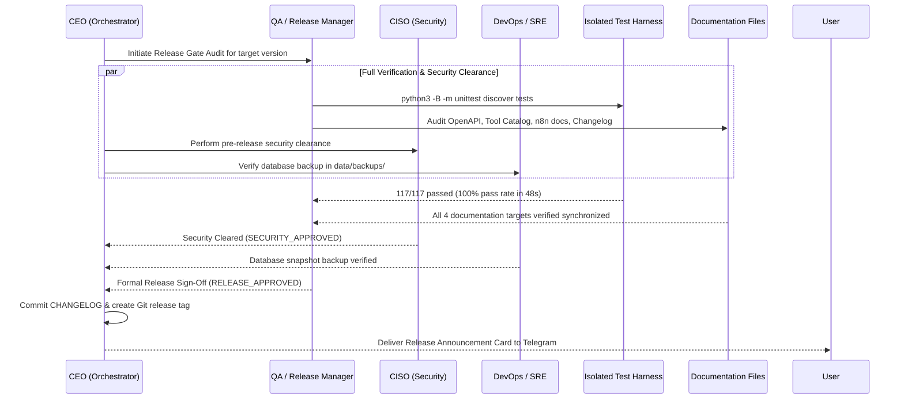

# Standard Workflow: Release Management (`release_management.md`)

**Workflow Identifier**: `wf_release_management`  
**Governing Roles**: CEO (`aegis-orchestrator`), QA/Release Manager (`aegis-qa`), CISO (`aegis-ciso`), DevOps/SRE (`aegis-devops`)  
**Strict Requirement**: 100% test pass rate required. Zero regressions tolerated. Full documentation synchronization mandatory.  
**Phase Output**: Formal `QA_VERIFICATION_REPORT`, `SECURITY_AUDIT_REPORT`, Git Version Tag, and `CHANGELOG.md` Release Notes.  

---

## 1. Trigger Conditions
- All planned tasks and bug fixes for a version milestone have reached completion.
- Developer explicitly requests release preparation or tagging (*"Prepare release v2.5.0"*, *"Release current milestone"*).
- Pre-deployment release gate validation directive from the CEO.

---

## 2. Initial Assessment
The CEO initiates the release gating sequence:
1. **Milestone Review**: Verifies that all target tasks in `ROADMAP.md` and `TASKS.md` are in `completed` status.
2. **Defect Ledger Check**: Confirms zero unresolved `CRITICAL` or `MAJOR` bugs in `BUGS.md` and SQLite.
3. **Dispatch to QA & CISO**: Convenes the Release Gatekeeping Council (QA Manager and CISO).

---

## 3. Required Agents & Separation of Duties
- **CEO (`aegis-orchestrator`)**: Initiates release audit, coordinates sign-offs, performs final Git tagging, and delivers release notes.
- **QA/Release Manager (`aegis-qa`)**: Executes full automated regression suites, enforces the 100% test pass rate, audits documentation synchronization, and issues release verdicts.
- **CISO (`aegis-ciso`)**: Performs pre-release security clearance, verifies secret isolation, and audits approval gates.
- **DevOps/SRE (`aegis-devops`)**: Verifies build packaging and database backup integrity prior to tagging.
- **Strict Separation**: QA Manager operates as an impartial gatekeeper; does not author code fixes or lower test standards.

---

## 4. Agent Execution Order & Workflow Lifecycle


---

## 5. Parallelizable Steps & Concurrency Boundaries
- **Parallel Gating Audits**: Full regression test execution, documentation synchronization auditing, security clearance checks, and database snapshot backups run concurrently.
- **Strict Synchronization Gate**: The CEO cannot sign off on the release until both QA (`RELEASE_APPROVED`) and CISO (`SECURITY_APPROVED`) deliver unanimous clearances.

---

## 6. Dependencies & Invariants
- **100% Pass Invariant**: Every single unit, integration, and regression test must pass. Zero skips or failures.
- **Zero Production Database Contamination**: All test suites must execute in isolated temporary environments.
- **Documentation Sync Invariant**: No undocumented endpoints, dispatcher tools, or schema changes may be released.
- **Backup Invariant**: A fresh verified database backup must exist in `data/backups/` before release tagging.

---

## 7. Required Tools & Capabilities
- **Automated Testing**: `run_tests` in isolated environment.
- **Inspection & Diffing**: `file_read`, `git_diff`, `git_status`, `git_log`.
- **Git Tagging**: `git_command(["tag", ...])`.
- **Database Backup**: DevOps database backup verification.

---

## 8. Expected Intermediate Results
1. **Full Test Execution Logs**: Console output showing 100% passing tests (e.g. 117/117).
2. **Documentation Audit Checklist**: Proof of sync across `openapi.json`, `AEGIS_N8N_TOOL_CATALOG.md`, `n8n_integration.md`, and `CHANGELOG.md`.
3. **Structured `QA_VERIFICATION_REPORT`**: In `docs/qa/`.
4. **Structured `SECURITY_AUDIT_REPORT`**: In `docs/security/`.

---

## 9. Approval Requirements & Security Gates
- Pre-release audits proceed under `RiskLevel.LOW`.
- Git release tagging on `main` and production deployments require explicit human authorization.

---

## 10. Failure Handling & Release Abortion
- If any test fails: QA immediately rejects the release (`RELEASE_REJECTED`), logs the failing assertions, and returns the issue to the CEO.
- If documentation is out of sync: QA halts the release until documentation updates are committed.
- Under no circumstances may a release proceed with failing tests or unverified documentation.

---

## 11. Final Verification & Quality Gates
1. Test suite achieves 100% pass rate (Exit code 0).
2. All 4 documentation targets confirmed synchronized.
3. CISO security clearance verified.
4. Git working tree is completely clean on `main`.

---

## 12. Completion Criteria
1. QA Manager issues formal `RELEASE_APPROVED` sign-off.
2. CISO issues formal `SECURITY_APPROVED` clearance.
3. `CHANGELOG.md` updated with release notes and committed.
4. Git release tag created.
5. Release delivery card sent to developer via Telegram.

---

## 13. User-Facing Reporting
```markdown
### 🚀 Release Approved & Tagged: [Version vX.Y.Z]

**Project**: [Project Name]
**Release Tag**: `v2.5.0`
**Commit**: `[commit_hash]`
**Status**: ✅ `RELEASE_APPROVED`

#### Quality Assurance & Verification Proof
- **Automated Test Suite**: `117/117 tests passed (100%)` in `48.2s`
- **Database Safety**: `VERIFIED` — Zero production database contamination
- **Security Audit**: `CLEARED` by `aegis-ciso` (Zero open CVEs, path sandboxed)
- **Database Snapshot**: Backup saved to `data/backups/aegis_v2.5.0.db`

#### Synchronized Documentation
- [CHANGELOG.md](file:///path/to/CHANGELOG.md) — Release Notes
- [OpenAPI Specification](file:///path/to/docs/openapi.json) — Synced
- [Tool Catalog](file:///path/to/docs/AEGIS_N8N_TOOL_CATALOG.md) — Synced
- [n8n Integration Guide](file:///path/to/docs/n8n_integration.md) — Synced
```
