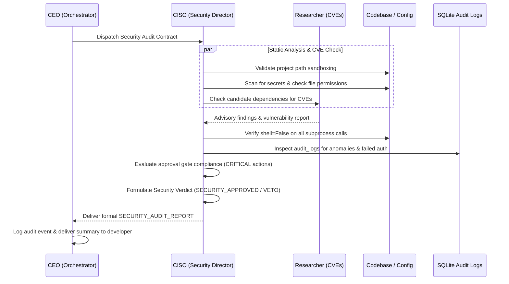

# Standard Workflow: Security Audit (`security_audit.md`)

**Workflow Identifier**: `wf_security_audit`  
**Governing Roles**: CEO (`aegis-orchestrator`), CISO (`aegis-ciso`), Researcher (`aegis-researcher`)  
**Strict Authority**: CISO holds absolute **VETO power** over any release or configuration failing security standards.  
**Phase Output**: Formal `SECURITY_AUDIT_REPORT`, STRIDE Threat Model, and Approval Gate Certification.  

---

## 1. Trigger Conditions
- Pre-release security gate check prior to milestone completion or deployment.
- Introduction of new API endpoints, external network connectors, or command execution tools.
- Suspected path traversal attempt, unauthorized token access, or audit anomaly.
- Dependency addition or version upgrade requiring supply chain vetting.
- Periodic scheduled security health check.

---

## 2. Initial Assessment
The CEO initiates the security audit:
1. **Audit Scope Definition**: Identifies target repository, newly modified files, API routes, or dependencies.
2. **Context Packaging**: Packages recent Git diffs, configuration files, permission states, and audit log excerpts into a delegation contract.
3. **Dispatch to CISO**: Issues formal audit directive to `aegis-ciso`.

---

## 3. Required Agents & Separation of Duties
- **CEO (`aegis-orchestrator`)**: Initiates audit, coordinates remediation handoffs if needed, and delivers audit report to user.
- **CISO (`aegis-ciso`)**: Audits path sandboxing, inspects tokens/permissions, runs vulnerability checks, evaluates STRIDE threat models, and issues binding security verdicts.
- **Researcher (`aegis-researcher`)**: Assists CISO by querying CVE vulnerability databases and security advisories for dependencies.
- **Strict Separation**: CISO operates strictly defensively and does not implement application features.

---

## 4. Agent Execution Order & Workflow Lifecycle


---

## 5. Parallelizable Steps & Concurrency Boundaries
- **Parallel Scanning**: CISO inspects codebase secrets, filesystem permissions, and command execution patterns in parallel with Researcher querying CVE databases.
- **Sequential Verdict**: The security verdict is formulated only after all parallel audit probes report findings.

---

## 6. Dependencies & Invariants
- **Sandboxing Invariant**: Every filesystem access must pass `validate_path_within_project()`. Traversal (`../`) must be rejected.
- **Localhost Invariant**: Daemon binding must be verified strictly to `127.0.0.1:8765`.
- **Token Protection Invariant**: `data/.api_token` must strictly have `0600` permissions and constant-time comparison (`secrets.compare_digest`).
- **No Plaintext Leaks**: No raw tokens, private keys, or passwords may exist in Git history, logs, or responses.

---

## 7. Required Tools & Capabilities
- **Static Inspection**: `file_read`, `filesystem_inspect`, `git_diff`, `git_log`.
- **Audit Ledger**: `audit_logs_get`.
- **Research**: `search_web` (CVE advisory search via Researcher).
- **Report Generation**: `create_file` (scoped strictly to `docs/security/`).

---

## 8. Expected Intermediate Results
1. **Sandboxing Verification Matrix**: Test results demonstrating path containment across all tools.
2. **Secret Scan Log**: Confirmation of `0600` permissions on secret files and absence of credentials in code.
3. **Dependency CVE Report**: Clean bill of health or list of flagged vulnerabilities from PyPI/npm advisories.
4. **Structured `SECURITY_AUDIT_REPORT` Artifact**: Document in `docs/security/SEC_YYYY_NNN.md`.

---

## 9. Approval Requirements & Security Gates
- Security audits operate under `RiskLevel.LOW` (read-only inspection).
- If the CISO discovers critical vulnerabilities, the CISO triggers an immediate **VETO**, halting the release pipeline until remediated.

---

## 10. Failure Handling & Emergency Lockdown
- If an active path traversal or hardcoded secret is detected:
  1. CISO issues emergency `VETO_REJECTED` verdict.
  2. CEO alerts the developer immediately via Telegram.
  3. CISO routes remediation specifications to Repair Engineer for emergency patching.
  4. Release pipeline remains completely frozen until re-audit passes.

---

## 11. Final Verification & Quality Gates
A security audit passes only when:
1. All file operations confirmed bounded by project roots.
2. No secrets detected in codebase or Git history.
3. All command executions confirmed pre-tokenized with `shell=False`.
4. All `RiskLevel.CRITICAL` operations confirmed protected by single-use approval gates.
5. CISO issues formal `SECURITY_APPROVED` verdict.

---

## 12. Completion Criteria
1. Formal `SECURITY_AUDIT_REPORT` authored and committed to `docs/security/`.
2. Security audit entry recorded in SQLite `audit_logs`.
3. Unambiguous security sign-off delivered to CEO.

---

## 13. User-Facing Reporting
```markdown
### 🛡️ Security Audit Complete: [Milestone / Target]

**Audit ID**: `SEC-[YYYY]-[NNN]`
**Auditor**: `aegis-ciso`
**Verdict**: ✅ `SECURITY_APPROVED`

#### Key Security Verifications
- **Path Sandboxing**: `VERIFIED` — All filesystem operations strictly contained
- **Secret Protection**: `VERIFIED` — Token permissions `0600`, zero leaks detected
- **Network Isolation**: `VERIFIED` — Daemon bound exclusively to `127.0.0.1:8765`
- **Command Safety**: `VERIFIED` — `shell=False` enforced across all executions
- **Dependencies**: `CLEAN` — Zero open CVEs identified

#### Deliverable
- [Security Audit Report](file:///path/to/docs/security/SEC_xxx.md)
```
