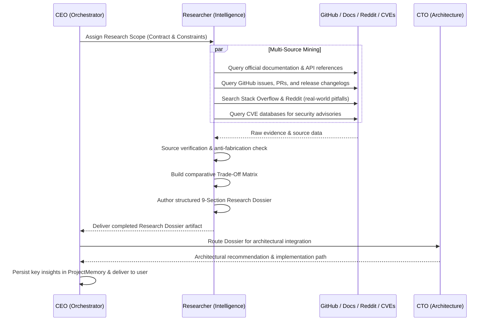

# Standard Workflow: Technology Research (`technology_research.md`)

**Workflow Identifier**: `wf_technology_research`  
**Governing Roles**: CEO (`aegis-orchestrator`), Researcher (`aegis-researcher`), CTO (`aegis-cto`)  
**Strict Mandate**: Zero fabrication policy. Every recommendation must cite authentic URLs, official documentation, and verified package versions.  
**Phase Output**: Formally cited 9-Section Research Dossier, Trade-Off Matrix, and Termux Compatibility Assessment.  

---

## 1. Trigger Conditions
- Evaluation of candidate third-party libraries, frameworks, or database engines.
- Technical research required for new project onboarding or architectural decisions.
- Investigation into upstream breaking changes, version migrations, or framework deprecations.
- Diagnosis of obscure runtime errors requiring community workarounds and maintainer consensus.

---

## 2. Initial Assessment
The CEO evaluates the research inquiry:
1. **Scope & Questions**: Defines the specific technical question to answer.
2. **Environment Constraints**: Identifies host constraints (Termux on Android, Linux aarch64, Python 3.14, Node.js).
3. **Evaluation Criteria**: Identifies critical priorities (e.g. pure-Python vs compiled C-extensions, RAM footprint, license).
4. **Task Dispatch**: Issues formal delegation contract to `aegis-researcher`.

---

## 3. Required Agents & Separation of Duties
- **CEO (`aegis-orchestrator`)**: Formulates research objectives, reviews completed dossiers, and routes findings to CTO.
- **Researcher (`aegis-researcher`)**: Mines multiple information channels (GitHub, docs, Stack Overflow, Reddit, CVEs), builds trade-off matrices, and authors dossiers.
- **CTO (`aegis-cto`)**: Evaluates research findings from an architectural perspective and determines implementation paths.
- **Strict Separation**: Researcher **never writes application code** or creates feature PRs directly.

---

## 4. Agent Execution Order & Workflow Lifecycle


---

## 5. Parallelizable Steps & Concurrency Boundaries
- **Parallel Information Gathering**: Web searches across official documentation, GitHub issue mining, Stack Overflow discussions, and CVE queries execute concurrently.
- **Sequential Synthesis**: Evidence verification and trade-off matrix construction occur sequentially following data collection.

---

## 6. Dependencies & Invariants
- **Zero Fabrication Invariant**: All library versions, API methods, and citations must be authentic and verifiable.
- **Termux Android Feasibility**: Must explicitly verify whether packages require compilation (clang, gfortran) or have pure-Python wheels.
- **Persistent Intelligence**: Key technological decisions must be recorded in SQLite memory for future recall.

---

## 7. Required Tools & Capabilities
- **Web Intelligence**: `search_web` (searches documentation, GitHub, Stack Overflow, Reddit).
- **Resource Reading**: `read_resource`, `file_read`.
- **Memory & Persistence**: `memory_search`, `memory_record`.
- **Dossier Generation**: `create_file` (scoped strictly to `docs/research/`).

---

## 8. Expected Intermediate Results
1. **Multi-Source Evidence Notes**: Curated excerpts from docs, GitHub, and developer forums.
2. **Comparative Trade-Off Matrix**: Structured markdown table evaluating performance, footprint, and maintenance.
3. **Structured 9-Section Research Dossier**: Document in `docs/research/RES_YYYY_NNN.md`.
4. **Persistent Memory Record**: SQLite memory entry storing bottom-line technical consensus.

---

## 9. Approval Requirements & Security Gates
- Research is a read-only investigation operating under `RiskLevel.LOW`.
- If research recommends introducing dependencies with non-permissive licenses (GPL, AGPL) or known CVEs, CISO approval is required.

---

## 10. Failure Handling & Inconclusive Research
- If available documentation is contradictory or sparse:
  1. Researcher highlights the discrepancy and identifies the maintainer vs community divide.
  2. Recommends creating an isolated spike / benchmark script to empirically test behavior.
  3. Formulates conservative fallback recommendation.

---

## 11. Final Verification & Quality Gates
A research dossier is verified when:
1. All 9 mandatory sections are complete and substantiated.
2. All cited links and version numbers are verified against package registries.
3. Clear compatibility assessment for Termux/Android is documented.
4. CTO confirms architectural feasibility.

---

## 12. Completion Criteria
1. Research Dossier authored and saved in `docs/research/`.
2. Key takeaways recorded in `ProjectMemory` via `memory_record`.
3. Actionable recommendation delivered to the CEO.

---

## 13. User-Facing Reporting
```markdown
### 📚 Technology Research Dossier: [Subject Title]

**Dossier ID**: `RES-[YYYY]-[NNN]`
**Researcher**: `aegis-researcher`
**Recommendation**: [Clear, unambiguous recommended technology / approach]

#### Comparative Trade-Off Highlights
| Option | Performance | Memory | Termux Support | Community Health |
|---|---|---|---|---|
| **Option A (Recommended)** | Excellent | Low (<30MB) | Native pure-Python | Highly active |
| **Option B** | Moderate | Medium | Requires clang | Moderate |

#### Key Insights & Pitfalls
- **Official Pattern**: [Maintainer-recommended best practice]
- **Known Trap**: [Community-reported edge case or breaking change]
- **Security Posture**: Clean (Zero open CVEs)

#### Full Dossier
- [Research Dossier Document](file:///path/to/docs/research/RES_xxx.md)
```
