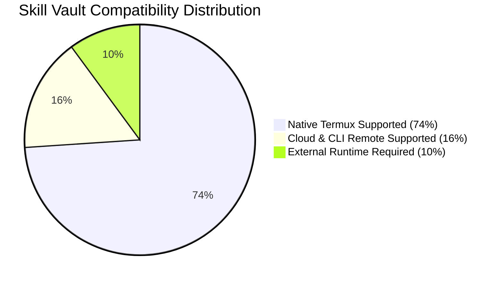

# Aegis Intelligence — Skill Compatibility & Host Matrix (`SKILL_COMPATIBILITY.md`)

**Governance Version**: 2.0.0  
**Host Environment**: Termux on Android (Linux `aarch64`, Android Kernel, Python 3.14.10, Node.js 24.22.3)  

---

## 1. Runtime Compatibility Classification

Skills in the 307-skill vault are categorized into three distinct operational compatibility tiers based on Termux and Android system boundaries:

### Tier 1: Native Termux Supported (74% — 227 Skills)
- **Characteristics**: Pure-language development, architectural runbooks, unit testing frameworks, code refactoring, Git workflows, and diagnostic guidelines.
- **Runtimes**:
  - Python 3.14 (FastAPI, pytest, unittest, standard library).
  - Node.js 24 / npm (TypeScript, React, Vite, Jest, ESLint).
  - SQLite 3 (WAL mode, pure SQL analysis).
  - POSIX Bash scripting (`safe_run_command`).
- **Examples**: `fastapi-pro`, `python-pro`, `typescript-pro`, `react-modernization`, `debugger`, `test-automator`, `security-auditor`, `bash-pro`.

### Tier 2: Cloud & CLI Remote Supported (16% — 49 Skills)
- **Characteristics**: Infrastructure as Code (IaC) templates, cloud architecture runbooks, and remote API management.
- **Termux Execution**: Operates smoothly via pure configuration analysis, schema validation, and remote REST API / CLI calls (e.g. Terraform syntax generation, Cloudflare API calls).
- **Examples**: `terraform-specialist`, `cloud-architect`, `sast-configuration`, `api-design-principles`.

### Tier 3: External Runtime Required (10% — 31 Skills)
- **Characteristics**: Heavy container daemon management (Docker, containerd), local Kubernetes clusters (Minikube, k3s), systemd services, or desktop GUI browser automation (headed Cypress).
- **Termux Limitation**: Android's Linux environment does not expose native systemd or root cgroups required for hosting local Docker / K8s daemons directly on-device.
- **Aegis Adaptation**: When an agent selects a Tier 3 skill (e.g. `k8s-manifest-generator`), the agent uses it for **declarative manifest authoring, static linting, and architecture review**, rather than attempting to launch a local Docker daemon inside Termux.

---

## 2. Toolchain & Node Engine Requirements

- **Node.js Engine**: Upstream `@rmyndharis/antigravity-skills` specifies `engines: { "node": ">=22" }`.
  - **Host Verification**: Termux is currently running **Node.js v24.22.3** (`/data/data/com.termux/files/usr/bin/node`), fully satisfying the engine constraint.
- **Python Runtime**: Termux is running **Python 3.14.10** (`/data/data/com.termux/files/usr/bin/python3`).
  - Pre-built wheels are preferred. Skills recommending C-extensions are vetted for clang availability.
- **Git Binary**: Termux Git 2.50+ is fully supported for all repository management skills.

---

## 3. Host Memory & Resource Protection (Android OOM Safety)

Android aggressively terminates background processes that exceed memory allocations:
1. **Catalog Parsing Footprint**: The centralized catalog (`skill_catalog.json`) is 229 KB on disk and parses into ~2.4 MB of memory in Python.
2. **On-Demand Loading Constraint**: Full `SKILL.md` packages average 4 KB to 12 KB each. Loading 1–3 skills consumes <50 KB of memory, leaving zero residual footprint after task completion.
3. **Bulk Installation Danger**: Installing all 307 skills into the active model prompt would inject ~45,000 to 150,000 tokens per request, overflowing Termux buffer pools and driving excessive LLM response latency.

---

## 4. Fallback Matrix for Unsupported Commands

| Upstream Skill Guidance | Termux Runtime Constraint | Aegis Defensive Fallback |
|---|---|---|
| `docker run -d ...` | Docker daemon unavailable in non-root Termux | Generate Dockerfile & compose spec; test in remote CI or cloud runner. |
| `systemctl restart ...`| Systemd unavailable on Android | Use direct process management (`ExecutionManager.start_job`). |
| `playwright test --headed`| No X11/Wayland display by default | Run in headless mode (`--headless`) or use mock HTTP fixtures. |
| `pkg install` / `apt install`| Requires root or package manager lock | Flag as `APPROVAL_REQUIRED` (RiskLevel.HIGH) before execution. |
