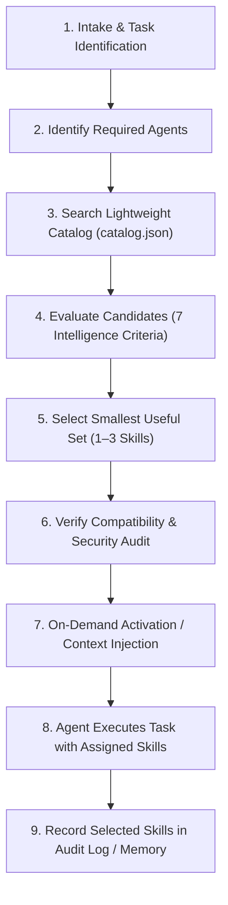

# Aegis Intelligence — Skill Routing & Selection Engine (`SKILL_ROUTING.md`)

**Governance Version**: 2.0.0  
**Engine Implementation**: [skill_system/selector.py](file:///data/data/com.termux/files/home/aegis-intelligence/skill_system/selector.py)  

---

## 1. The 9-Step CEO Skill Selection Engine

When a developer submits a request, the CEO routes skills through an intelligent 9-step selection pipeline:

### Step Breakdown:
1. **Task Identification**: The CEO analyzes the incoming prompt, extracting key technical nouns, frameworks, programming languages, and operations (e.g. *"Build async FastAPI endpoints for user login"*).
2. **Agent Assignment**: The CEO assigns the primary agent responsible according to `SUMMONING_RULES.md` (e.g. `aegis-repair-engineer`).
3. **Lightweight Catalog Search**: `SkillSelector.search_catalog()` scans `skill_catalog.json` (307 entries) using keyword, alias, trigger, and tag indexing.
4. **Candidate Evaluation**: Applies the 7-factor evaluation algorithm (detailed in Section 2).
5. **Smallest Set Selection**: Selects between 1 and 3 skills, discarding near-duplicate or overlapping skills.
6. **Compatibility & Security Audit**: Statically audits candidate instructions for Termux feasibility, forbidden commands, and credential safety.
7. **On-Demand Activation**:
   - For single-turn tasks: Loads the `SKILL.md` text directly into the agent's delegation prompt contract.
   - For multi-turn project development: Activates the skill into the project workspace (`.agents/skills/<skill_id>/SKILL.md`).
8. **Specialist Execution**: The agent executes the assignment, referencing the structured guidance from the active skill.
9. **Persistence & Telemetry**: The CEO logs the activated skill IDs in `audit_logs` and records domain patterns in `ProjectMemory`.

---

## 2. Multi-Factor Evaluation & Scoring Algorithm

Every candidate skill is scored across seven distinct evaluation dimensions:

$$\text{Total Score} = \text{Relevance} + \text{Agent Affinity} + \text{Tech Compatibility} + \text{Termux Bonus} + \text{Vault Status} - \text{Overlap Penalty}$$

### Dimension 1: Task Relevance (Mandatory Base Filter)
- **Word-Boundary Trigger Match**: +15.0 points per matching trigger phrase.
- **Word-Boundary Tag Match**: +10.0 points per matching tag.
- **Skill Name Part Match**: +15.0 points if a significant word (>2 chars) from the skill name appears in the task.
- **Zero Relevance Gate**: If task relevance is 0.0, the skill is **immediately rejected**, regardless of agent affinity.

### Dimension 2: Agent Role Affinity
- **Curated Agent Skill**: +35.0 points if the skill is listed in the agent's `curated_skills` list in `agent_skill_mapping.json`.
- **Primary Category Match**: +20.0 points if the skill belongs to the agent's `primary_categories`.
- **Target Agent Tag**: +15.0 points if the skill metadata lists the agent in `target_agents`.
- **Out-of-Domain Penalty**: -10.0 points if the category falls outside the agent's primary domain.
- **Forbidden Category Veto**: Immediate rejection if the skill falls under the agent's `forbidden_categories` (e.g. Bug Hunter cannot use code modification skills).

### Dimension 3: Project Technology Compatibility
- **Exact Stack Match**: +25.0 points if the skill matches an active project language or framework (e.g. `FastAPI`, `React`, `Python`, `Node.js`).
- **Description Match**: +15.0 points if the project technology is referenced in the skill's description.

### Dimension 4: Termux / Android Runtime Feasibility
- **Native Termux Support**: +5.0 points for pure-Python, pure-Node, bash, or text instruction skills.
- **External Dependency Requirement**: -20.0 points if the skill requires a desktop daemon or container runtime not available natively in Termux (e.g. Docker, desktop GUI browsers).

### Dimension 5: Vault Availability Bonus
- **Pre-Audited Vault Skill**: +10.0 points if the skill is stored in `skill_system/vault/` and has passed pre-flight security auditing.

### Dimension 6: Overlap Pruning (Anti-Bloat Filter)
- If two candidate skills share 3 or more common tags (e.g. two generic Python formatting tools), only the highest-scoring skill is retained.

---

## 3. Dynamic Override Policy

While `agent_skill_mapping.json` establishes strict boundaries, real-world development may require cross-domain skills:

1. **Justified Request**: A specialist may request an out-of-domain skill if an unexpected dependency arises (e.g. Repair Engineer requesting `devops-troubleshooter` when a build toolchain fails).
2. **CEO Approval Gate**: The CEO evaluates whether the request violates constitutional rules:
   - ✅ **Permitted**: Repair Engineer requesting build or deployment troubleshooting skills.
   - ❌ **Forbidden**: Bug Hunter requesting code modification skills (violates separation of duties).
   - ❌ **Forbidden**: Any agent requesting skills that bypass approval gates or disable path sandboxing.

---

## 4. Handling Missing Skills (Zero Hallucination Standard)

If no candidate skill achieves a minimum score of 25.0 or task relevance is zero:
1. `SkillSelector` returns an empty selection list (`[]`).
2. Generates an explicit notice: `"No matching vetted skill found in catalog for this specific task."`
3. The assigned agent **proceeds using its baseline capabilities**, without hallucinating non-existent skills or fabricating syntax.
4. The CEO notes the missing capability in `data/aegis.db` for future skill vault additions.
